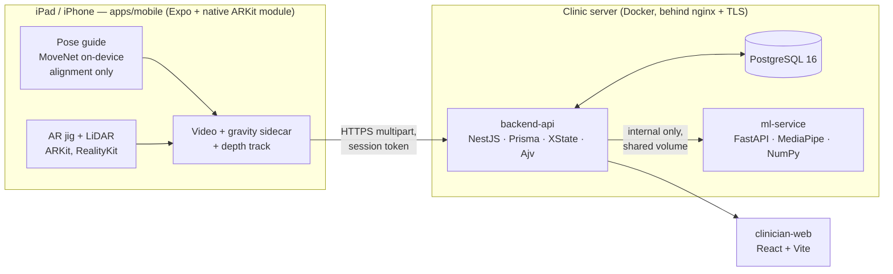
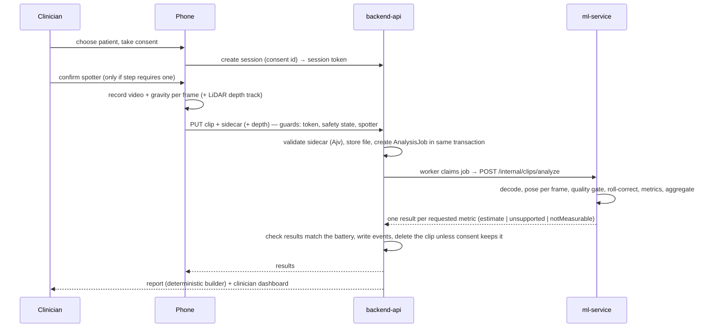

# PosturePulse AI (beAIve) — End-to-End Architecture, Mathematics and Technology

Status as of 2026-11-06 · branch `v2-brand` · code reference commit `a2e4de7`

This document follows one posture assessment from the moment a clinician opens the app to the
number on the report, and derives every piece of mathematics on the way. It describes what the
code does today. Where something is built but not switched on, it says so (section 19).

> **Claims boundary.** The system estimates *visible geometry* with an uncertainty. It does not
> diagnose, score, grade or interpret, and nothing in it is clinically validated. Every protocol is
> `status: draft`, `clinicallyValidated: false`. A clinician reads the numbers; the software does not.
> See `docs/claims-and-scope.md`.

Contents

1. [System at a glance](#1-system-at-a-glance)
2. [Technology stack](#2-technology-stack)
3. [The journey of one clip](#3-the-journey-of-one-clip)
4. [Capture on the device](#4-capture-on-the-device)
5. [Backend: sessions, consent, safety, upload, jobs](#5-backend-sessions-consent-safety-upload-jobs)
6. [Pose estimation](#6-pose-estimation)
7. [Quality gating](#7-quality-gating)
8. [Maths I — frames, gravity, roll, pitch](#8-maths-i--frames-gravity-roll-pitch)
9. [Maths II — the 2D metric formulas](#9-maths-ii--the-2d-metric-formulas)
10. [Maths III — uncertainty, aggregation, comparison](#10-maths-iii--uncertainty-aggregation-comparison)
11. [Maths IV — the 2.5D LiDAR path](#11-maths-iv--the-25d-lidar-path)
12. [Maths V — head pose from the face](#12-maths-v--head-pose-from-the-face)
13. [Maths VI — signal processing](#13-maths-vi--signal-processing)
14. [Maths VII — validation statistics and minimal detectable change](#14-maths-vii--validation-statistics-and-minimal-detectable-change)
15. [Results, tiers, references and reports](#15-results-tiers-references-and-reports)
16. [Safety model and hazards](#16-safety-model-and-hazards)
17. [Security and privacy](#17-security-and-privacy)
18. [Deployment](#18-deployment)
19. [Built, wired, dormant, pending](#19-built-wired-dormant-pending)
20. [Limits of what the numbers mean](#20-limits-of-what-the-numbers-mean)
21. [Where to find things](#21-where-to-find-things)

---

## 1. System at a glance

Three rules shape everything below.

1. **Safety outranks AI.** A reported symptom pauses the session whatever any model says.
2. **Never fabricate a measurement.** If quality, scale or identity is insufficient the result is an
   explicit `unsupported` with reasons — never a guess, never a silent omission.
3. **Every record carries its provenance** (schema, model, calibration, metrics versions), so a
   number found years later can be traced to what produced it.

Only the clinic server computes anything a clinician sees. The phone's own model exists to help
the operator frame the shot.

---

## 2. Technology stack

| Layer | Technology | Version | Why it is there |
|---|---|---|---|
| Mobile app | Expo / React Native, Expo Router | Expo 58, RN 0.88.1, React 19.3 | One codebase, file-based routing, EAS builds |
| Camera | react-native-vision-camera | 5.x | Frame access, locked portrait recording |
| On-device pose | react-native-fast-tflite + MoveNet Lightning | 3.x | 4.7 MB model for alignment guidance only |
| Native capture | Swift: ARKit, RealityKit, AVFoundation (`modules/ar-jig`) | iOS | LiDAR depth, metric floor template, exact intrinsics |
| Device motion | expo-sensors DeviceMotion | 58 | Gravity vector per frame |
| Secrets on device | expo-secure-store (iOS Keychain) | 58 | Clinician token storage |
| Backend API | NestJS, Prisma ORM | Nest 10.4, Prisma 5.22 | Session lifecycle, event log, job queue |
| Safety state machine | XState | 5.19 | Safety rules as a graph, not handler code |
| Schema validation | Ajv against JSON Schema | 8.17 | One source of truth for every record |
| Database | PostgreSQL | 16 | Records, append-only events, `FOR UPDATE SKIP LOCKED` queue |
| ML service | FastAPI + Uvicorn | 0.115 / 0.32 | Internal-only analysis API |
| Pose model | MediaPipe Tasks (Pose Landmarker, Face Landmarker) | 1.x | 33 body landmarks, 478-point face mesh |
| Video decode | PyAV | 14–19 | Frame-exact decode with rotation applied |
| Numerics | NumPy only | 1.26+ | No SciPy by design (see below) |
| Contracts | JSON Schema → generated TypeScript + Pydantic | 22 schemas | Edited in `packages/schemas/src`, generated elsewhere |
| Clinician web | React 19, Vite 8, Vitest 5 | | Read-only review dashboard |
| Infra | Docker Compose, host nginx, Let's Encrypt | | One shared host, TLS 1.2+ |
| Build | EAS Build (iOS ad hoc / TestFlight) | | Cloud builds, internal distribution |

**Deliberately absent: SciPy and OpenCV as direct dependencies.** Butterworth design, `filtfilt`,
the rigid head-pose solver and every statistic in section 14 are written in NumPy and verified
against the *properties* they must have (−3 dB at cutoff, exact zero phase, `R·g = [0,1,0]` to
1e-12), so the absence is not a gap in verification. A measurement path that depends on another
package's transitive dependencies loses capabilities silently when a pin elsewhere moves.

---

## 3. The journey of one clip

In words:

1. **Capture** — a 30-second hold per view, recorded with per-frame gravity and, on supported
   iPads, a LiDAR depth track.
2. **Upload** — the sidecar is validated against the schema; a paused session accepts nothing.
3. **Analysis** — pose per frame → quality gate → roll correction → per-frame metric →
   robust aggregation with uncertainty.
4. **Optionally** — depth path (`static3d.*`) and a head-pose diagnostic.
5. **Results** — one of three shapes, each with provenance.
6. **Report** — a pure function turns results plus a reference set into rows. The clinician writes
   the interpretation; the builder never does.

---

## 4. Capture on the device

### 4.1 Camera and protocol

| Setting | Value | Reason |
|---|---|---|
| Resolution target | 1080 × 1440 portrait (3:4) | 4:3 uses the whole sensor; 16:9 crops the sides |
| Frame rate | 30 fps (battery minimum 24) | Enough frames for robust medians |
| Bit rate | 6 Mbit/s | ≈ 22 MB per 30 s, inside the 100 MB nginx limit |
| Hold | 30 s, first second discarded server-side | Lets the subject settle |
| Audio | off | Never recorded |
| Orientation | locked portrait | A tilted iPad otherwise yields sideways frames |

The current draft battery (`references/assessment-battery.v0-draft.json`) is four static holds:
anterior, left lateral, right lateral, posterior. It declares 15/5/5/5 s while the app records 30 s
per step from one constant — a known inconsistency that waits on battery authoring. The
multi-block structure (relaxed → habitual → standardised sub-phases, tagged per frame at capture
time in `sub-blocks.ts`) and balance steps exist in the schema and app but **no step uses them yet**.

### 4.2 The gravity sidecar

While recording, device motion is sampled at ≈ 60 Hz. Linear acceleration is subtracted from
total acceleration so a moving phone still reports "down". The sidecar carries, per encoded frame:
index, presentation time, and the interpolated unit gravity vector in the camera frame.

Two guards stop a fabricated sidecar from being uploaded: **no readings at all** fails loudly (a
sidecar of zeros would say "free fall" and corrupt every angle), and **thin coverage** (< half the
recording) fails too. Dimensions and frame times come from the *recorded file's own container
metadata*, not from the requested settings — an early version reported requested dimensions and
every metric of every clip came back unmeasurable.

### 4.3 The AR jig and the depth track (ADR-020)

The native module draws a 60 × 40 cm floor mat anchored in the room and locks recording until
camera level, distance, height and foreground clearance hold continuously. It draws **no text**:
all user-facing copy lives in React so the claims lint can see it.

When LiDAR is available a second file travels with the clip:

| Property | Value |
|---|---|
| Magic / version | `BEAIVEDP`, v1, 16-byte header |
| Resolution | 256 × 192 depth map |
| Rate | 15 Hz (the subject is static; 60 Hz would be wasted bytes) |
| Encoding | `uint16_millimetres_deflate`: per frame, a length-prefixed **raw DEFLATE** stream |
| Contents | uint16 depth in mm along the optical axis (0 = no return) + optional uint8 confidence 0–2 |
| Convention | **planar depth along the optical axis**, not range along the ray (ARKit `sceneDepth`) |
| Size | ≈ 98 KB/frame raw → ≈ 10–15 MB compressed for 30 s |

The header repeats width, height and the confidence flag that the sidecar also declares. A
disagreement is a transport bug and the track is refused rather than decoded under either party's
assumption. The sidecar also carries true camera intrinsics (`fx, fy, cx, cy`); the server never
synthesises `fx` from an assumed field of view, because a guessed `fx` is a guessed metric scale.

### 4.4 The on-device pose guide

MoveNet SinglePose Lightning (float16, 192 × 192 input, 17 keypoints) runs at ≈ 10 Hz to help
framing. It is **never** used for a measurement: MoveNet has no heel keypoint and the two models
disagree slightly on joint centres, so mixing them would inject an unexplained bias. A skeleton is
drawn only when the frame looks like a person (≥ 8 of 17 keypoints ≥ 0.4 for frontal views, ≥ 6 for
lateral, plus a torso check), because MoveNet returns 17 low-score keypoints for an empty desk.

Each on-screen check is stricter than its server counterpart so that passing on screen implies
passing on the server: head/feet inside the frame, horizontal margin 5–95 %, distance by
head-to-ankle span 0.55–0.78 of frame height, centred within 8 %, left–right tilt ≤ 3° (corrected
later), forward–back tilt ≤ 5° (server rejects at 12°).

---

## 5. Backend: sessions, consent, safety, upload, jobs

**Identity separation.** The patient register holds encrypted names; everything downstream holds
only a pseudonymous subject id. Names are encrypted at rest under `PATIENT_DATA_KEY`, kept outside
the database and backed up separately.

**Consent first.** A session cannot be created without a consent record. After analysis the job
runner deletes the clip file unless the session's consent explicitly includes a scope that keeps
it (`raw_video` is its own scope). Deletion also runs on the failure path.

**Two kinds of token.** A clinician JWT authorises the workflow. Clip upload uses a separate
session-scoped subject token, and the upload guard rejects a clinician token outright, keeping a
long-lived credential out of the upload path.

**Upload guards, in order.** Valid session token → session not in a paused state → sidecar valid
against the schema → if the battery step sets `requiresSpotter`, a clinician-attested spotter
confirmation must exist for that step (HZ-09; section 16).

**Job queue.** The clip row and an `AnalysisJob` row are created in one transaction, so a job only
becomes visible after the file is in place. Workers claim jobs with PostgreSQL
`FOR UPDATE SKIP LOCKED` (concurrency 4). A worker calls ml-service, then `checkResults` verifies
the response against the battery: every requested key must have exactly one result (per side where
applicable), and **any result for a key the battery did not request fails the job**. That is how a
metric stays structurally dormant until a clinician lists it.

---

## 6. Pose estimation

| Property | Value |
|---|---|
| Model | MediaPipe Pose Landmarker (full, float16) |
| Output | 33 landmarks per frame with visibility |
| Mode | VIDEO (tracks across frames), one pose |
| Pairing | decoded frame *i* ↔ sidecar frame *i*; sidecar time becomes the timestamp |
| Coordinates | landmark x, y scaled to the **oriented** image in pixels |

Fatal rather than recoverable: no video stream, a rotation that is not a multiple of 90°, or a
decoded size that disagrees with the sidecar. A frame with no pose (or ≠ 33 landmarks) keeps
`points = None`; nothing is interpolated from a neighbour. Throughput ≈ 19 frames/s per clip.
Inference is sequential inside a clip, so extra cores add parallel *clips*, not speed per clip.

The heels are the reason the on-device guide cannot stand in for this model: several metrics and
the body-height scale depend on them.

---

## 7. Quality gating

A clip is measured only from frames passing every check. If too few pass, the clip returns reasons
instead of numbers. The vocabulary (schema `quality-gate-flag`) holds the original twelve codes
plus four depth-specific ones (`depth_unavailable`, `insufficient_depth_samples`,
`depth_landmark_disagreement`, `torso_plane_underdetermined`).

**Per frame** (first 1.0 s skipped):

- every required landmark inside 2 %–98 % of the frame (`out_of_frame`)
- visibility ≥ 0.5 for each (`occlusion`)
- correct view: for anterior, the left shoulder appears right of the right shoulder in the image
  (reverse for posterior); for lateral, shoulders narrow relative to torso height (ratio ≤ 0.35)
  and the near side more visible than the far side (`wrong_view`)

**Per clip:**

| Check | Rule |
|---|---|
| Usable frames | ≥ 10 and ≥ 50 % of the hold |
| Camera level | median pitch ≤ 2 × the step's tolerance (12° for the static battery) |
| Frame rate | measured rate ≥ the step minimum (24 fps) |
| Scale | a positive median body height H in pixels |
| Stillness | spread of roll-corrected hip position ≤ 2 % of H (`subject_moving`) |

**A known blind spot, found and documented, not yet closed:** the anterior check is
`l_sh[0] > r_sh[0]`, which passes any subject yaw below 90°. Nothing in the 2D path gates axial
rotation. This is the motivation for ADR-020 (section 11).

The rule behind all of it: a quality failure never degrades into an approximate number.

---

## 8. Maths I — frames, gravity, roll, pitch

Every angle is measured against **true vertical**, recovered from the phone's gravity vector, not
against the image edges. A 3° tilted image would otherwise add 3° to every postural angle.

### 8.1 The camera frame (frame C)

- **x** → image right, **y** → image **down**, **z** → along the optical axis, away from the camera.
- A level phone filming upright reports gravity ≈ **[0, +1, 0]**.
- `y = down` is kept in every later frame so every sign convention carries over unchanged.

Device axes in portrait are x right, y up, z out of the screen, so image-down is −y and the rear
camera's axis is −z:

$$\mathbf g_{\text{cam}}=\frac{1}{\lVert\mathbf g\rVert}\bigl(g_x,\,-g_y,\,-g_z\bigr),\qquad \mathbf g=\mathbf a_{\text{incl. gravity}}-\mathbf a_{\text{linear}}$$

### 8.2 Roll — fully recoverable in 2D

Roll is rotation about the optical axis. Gravity's in-plane part is $(\sin\varphi,\cos\varphi)$, so

$$\varphi=\operatorname{atan2}(g_x,\,g_y)$$

Rotating every landmark about the image centre by $\varphi$ maps that vector to $(0,1)$:

$$\begin{bmatrix}x'\\y'\end{bmatrix}=\begin{bmatrix}\cos\varphi&-\sin\varphi\\ \sin\varphi&\cos\varphi\end{bmatrix}\begin{bmatrix}x-c_x\\y-c_y\end{bmatrix}+\begin{bmatrix}c_x\\c_y\end{bmatrix}$$

Check: $x'=\cos\varphi\sin\varphi-\sin\varphi\cos\varphi=0$, $y'=\sin^2\varphi+\cos^2\varphi=1$. This is done
**per frame** from that frame's own gravity. If the device is nearly flat, gravity has no in-plane
direction and the rotation is zero rather than amplified noise.

### 8.3 Pitch — measured, not correctable in 2D

$$\theta=\arcsin\!\left(\frac{\lvert g_z\rvert}{\lVert\mathbf g\rVert}\right)$$

Tilting back foreshortens the body non-uniformly and no 2D rotation undoes that, so pitch is only
used to reject (`camera_not_level`). A degenerate gravity returns 90° so it can never pass a level
check. This asymmetry explains the app's two limits: roll is tolerated to 3° (corrected), pitch is
held to 5° on screen (not corrected).

### 8.4 Full gravity alignment — roll **and** pitch (used by the depth path)

With depth, whole 3D points exist and a 3D rotation $R_g$ can level both. The target is
$\mathbf t=[0,+1,0]$ (not $[0,-1,0]$: that flips every coronal and sagittal sign while leaving
every magnitude plausible). The axis and angle:

$$\mathbf v=\mathbf g\times\mathbf t=[-g_z,\,0,\,g_x],\qquad \mathbf k=\frac{\mathbf v}{\lVert\mathbf v\rVert},\qquad \vartheta=\operatorname{atan2}(\lVert\mathbf v\rVert,\ \mathbf g\cdot\mathbf t)$$

$$R_g=I+\sin\vartheta\,[\mathbf k]_\times+(1-\cos\vartheta)\,[\mathbf k]_\times^{2}$$

Why this form and not the compact $R=I+[v]_\times+[v]_\times^2/(1+c)$: the compact one divides by
$1+c$, which underflows near antiparallel — measured 1.8e-4 off-target at 1e-6 rad from inverted,
4.7e-2 at 1e-7, `nan` below ~1e-8. The explicit angle form was measured at ≤ 1.0e-15 error over
0–180° pitch. A negated axis does not merely fail: it produces the *transpose*, which **doubles**
the tilt (10° becomes 20°), invisible in any magnitude — so the tests assert $R\,\mathbf g=[0,1,0]$
to 1e-12 rather than "looks reasonable". $R_g$ does **not** remove free yaw about gravity,
translation, metric-scale error, lens distortion or depth bias.

---

## 9. Maths II — the 2D metric formulas

Thirteen definitions, computed per frame on roll-corrected landmarks, in the image plane
(`measurementMethod: mediapipe_2d_image_plane`). $H$ is stature in pixels: the vertical distance
from the nose to the heel(s), taken as a median over usable frames. Offsets are therefore a
percentage of body height — the system has **no metric distance** in 2D.

Notation: $s_{\text{lat}}=+1$ (anterior) or $-1$ (posterior); $s_{\text{fwd}}=\pm1$ so "positive =
forward" regardless of which side faces the camera; "up" = decreasing image y.

**Frontal views**

| Metric | Formula | Sign |
|---|---|---|
| Head / shoulder / hip line tilt | $\alpha=\operatorname{atan2}(y_L-y_R,\ \lvert x_L-x_R\rvert)$ | + = person's left side lower |
| Trunk lateral lean | $\beta=\operatorname{atan2}(\Delta x\,s_{\text{lat}},\ \Delta y_{\text{up}})$, hip-mid → shoulder-mid | + = toward the person's left |
| Lateral body shift | $(x_{\text{sh-mid}}-x_{\text{ank-mid}})\,s_{\text{lat}}\,/H\times100$ | + = shoulders left of ankles |
| Knee frontal alignment (per leg) | $180^\circ-\angle(\text{hip},\text{knee},\text{ankle})$, signed by which side of the hip–ankle line the knee lies | + = knee displaced toward the midline |

**Lateral views** (near side only)

| Metric | Formula |
|---|---|
| Plumb offset (ear, shoulder, hip, knee) | $\dfrac{(x_{\text{part}}-x_{\text{ankle}})\,s_{\text{fwd}}}{H}\times100$ |
| Head–shoulder angle | $\gamma=\operatorname{atan2}(\Delta y_{\text{up}},\ \Delta x_{\text{fwd}})$ (shoulder → ear; 90° = ear above shoulder) |
| Trunk inclination | $\delta=\operatorname{atan2}(\Delta x_{\text{fwd}},\ \Delta y_{\text{up}})$ (hip → shoulder from vertical) |
| Knee extension | $180^\circ-\angle(\text{hip},\text{knee},\text{ankle})$, + if the knee is behind the hip–ankle line |

The joint angle is $\arccos\!\bigl(\tfrac{\mathbf v_1\cdot\mathbf v_2}{\lVert\mathbf v_1\rVert\lVert\mathbf v_2\rVert}\bigr)$ with
$\mathbf v_1=\text{hip}-\text{knee}$, $\mathbf v_2=\text{ankle}-\text{knee}$, the cosine clipped to $[-1,1]$.

Note the swapped `atan2` arguments between head–shoulder (from horizontal) and trunk inclination
(from vertical).

**Guards.** Each formula can refuse for a frame: coincident landmarks, or an "up" component ≤ 0
(hips above shoulders), return nothing for that frame. The frame contributes no value rather than
a nonsense one.

### 9.1 Why 2D coronal angles are biased by subject yaw (the reason for ADR-020)

Take a line of true length $L$ and true tilt $\alpha$, turned by yaw $\psi$ about the vertical. Its
horizontal extent shrinks by $\cos\psi$ while its vertical extent is unchanged, so the image shows

$$\tan\alpha_{\text{img}}=\frac{\tan\alpha_{\text{true}}}{\cos\psi}$$

A true 6° shoulder tilt at 30° yaw: $\tan 6^\circ=0.1051$, $/\cos30^\circ=0.8660$ gives $0.1214$,
i.e. **6.92°** — a 0.9° inflation presented against a reference range as if it were a tilt. The
2D system cannot see $\psi$; the depth path can.

---

## 10. Maths III — uncertainty, aggregation, comparison

Every published value carries an uncertainty in the same unit; the schema makes it mandatory.

### 10.1 Per-landmark position uncertainty

$$\sigma_{\text{lm}}=\frac{f\,H}{\max(v,\,v_{\min})},\qquad f=0.01,\quad v_{\min}=0.5$$

$f$ is a **declared engineering default** ("DRAFT — not derived from data"), not a measured value.
Scaling by $H$ makes the same posture at two distances comparable.

### 10.2 Propagation to an angle

For an angle from two points at distance $L$, errors add in quadrature and divide by the chord:

$$\sigma_{\text{angle}}=\frac{\sqrt{\sigma_a^2+\sigma_b^2}}{L}\quad[\text{rad}]$$

The small-angle form of "a perpendicular wobble at each end becomes an angle". Geometric
consequence: **a short line is a noisy angle.** The ear-to-shoulder line is short, which is why
head angles carry far more uncertainty than shoulder tilt. Joint angles use the same idea per limb
segment, combined in quadrature.

### 10.3 Aggregation across frames

$$\text{value}=\operatorname{median}_i(x_i),\qquad \sigma=\sqrt{\underbrace{\overline{\sigma_i^2}}_{\text{model}}+\underbrace{(1.4826\cdot\mathrm{MAD})^2}_{\text{spread}}}$$

- The **median** keeps one badly detected frame from dragging the result.
- $1.4826$ converts MAD to the equivalent standard deviation for normal data.
- The two terms answer different questions: *how well were landmarks located* vs *did the person
  hold still*. A swaying subject gets a large σ even if every frame was detected perfectly.
- **σ is not divided by √N**, deliberately. The dominant errors — landmark-to-bony-landmark offset,
  soft tissue and clothing, the model's left/right joint-centre asymmetry — are *static across a
  hold*, so averaging frames cannot touch them. Reporting σ/√30 would claim precision the
  instrument does not have.
- Reported σ is rounded **up** to 0.01, never down (with the quotient rounded first so float noise
  such as `0.07/0.01 = 7.000000000000001` cannot add a step).

### 10.4 Comparing two scans (`apps/mobile/src/lib/compare.ts`)

$$\lvert A-B\rvert\le\sqrt{\sigma_A^2+\sigma_B^2}\ \Rightarrow\ \text{“within the combined uncertainty”}$$

Never "improved", "worsened" or "stable". A missing uncertainty is never treated as 0 — the pair is
simply not judged. With two scans the sample deviation is $\lvert A-B\rvert/\sqrt2$ and is only
indicative. This is deliberately *weaker* than a minimal detectable change (section 14), which
needs between-session data that does not exist yet.

---

## 11. Maths IV — the 2.5D LiDAR path

ADR-020 (status **Proposed**; clinical sign-off pending). Goal: a depth-derived path running
**alongside** 2D. Its primary job is to measure subject yaw (to gate and de-bias 2D), its secondary
job is axial trunk twist, which 2D cannot measure at all. 2D remains primary.

### 11.1 Intrinsics and the pixel-centre convention

The depth map (256×192) and video (e.g. 1080×1440) are the same camera at different resolutions.
Intrinsics are rescaled with the **pixel-centre** rule, because a pixel's coordinate names its
centre, not its corner:

$$c_x'=(c_x+\tfrac12)\,\tfrac{W'}{W}-\tfrac12,\qquad f_x'=f_x\,\tfrac{W'}{W}$$

The naive $c_x\,W'/W$ is off by half a destination pixel — about 7 mm of lateral error at 2.5 m, which
looks like noise and biases yaw.

**Which intrinsics do what:** the depth *value* is read from the depth map, but unprojection uses
the **video** intrinsics at **video** pixel coordinates (in-plane position is known to video
resolution, several times finer than the depth grid). Depth-map intrinsics only convert a metric
patch radius into depth pixels and locate the landmark in the depth grid.

### 11.2 Back-projection

ARKit depth is planar along the optical axis ($Z=d$, no $\cos$ correction — treating range as planar
inflates off-centre points):

$$X=\frac{(u-c_x)\,Z}{f_x},\qquad Y=\frac{(v-c_y)\,Z}{f_y},\qquad Z=d$$

The Jacobian with respect to $(u,v,Z)$:

$$J=\begin{bmatrix}Z/f_x&0&(u-c_x)/f_x\\0&Z/f_y&(v-c_y)/f_y\\0&0&1\end{bmatrix}$$

Its third column is the viewing ray $(X/Z,\,Y/Z,\,1)$: **depth error displaces a point along the ray,
not along $z$.** That is why the full 3×3 covariance is carried everywhere and never collapsed to a
scalar.

### 11.3 Depth sampling — and every refusal

LiDAR gives only ≈ 150 real returns per m² at 2.5 m (return density scales as $1/Z^2$), so most
pixels are upsampled from a return centimetres away. Therefore:

- **Never read depth at one pixel.** Read a **median over a patch**, torso radius 7 cm (extremity
  3.5 cm), converted to depth pixels per frame so it covers a fixed amount of *body*.
- **Never infer a missing sample.** No nearest-valid-pixel search, no inpainting, no growing
  window. Every rejection returns `None`; the metric is suppressed (rule 3).

Ordered rejection gates:

| Gate | Threshold | What it catches |
|---|---|---|
| Invalid / non-finite / 0 mm | — | no return |
| ARKit confidence | ≥ 1 (medium) | high alone is too sparse on dark matte clothing |
| Silhouette erosion | 2 **depth** pixels ≈ 2.1 cm | 6 *video* px is only ≈ 1.07 depth px and erodes nothing |
| Minimum pixels | ≥ 9 | median of one or two returns |
| Patch MAD | ≤ 30 mm | patch straddling body and wall |
| **Consensus** | ≥ 80 % of pixels within MAD of the median | MAD is *robust*, so a patch 53 % wall / 47 % body has median on the wall and MAD = 0 — robustness lets the majority surface win silently |
| Body-depth plausibility | ≤ 0.35 m from the body median | a patch wholly on a flat background passes every other gate |

Per frame, depth frames are paired with video frames only within **0.1 s**. A frame needs all four
torso landmarks (both shoulders, both hips); a missing one drops the frame — it is never completed
from a neighbour. Every drop is counted by reason and reported (`torsoFrames.dropped`,
`landmarkRejections`), so "why is there no depth metric" has an answer.

### 11.4 Where the depth uncertainty comes from — physics, not the test fixture

Effective independent returns in a square patch of half-width $r$ at depth $Z$:

$$n_{\text{eff}}=(2r)^2\cdot150\cdot\left(\frac{2.5}{Z}\right)^2$$

For $r=7$ cm at 2.5 m: $0.0196\times150=2.94$. Per-point precision is 20 mm, and the median of $n$
Gaussian samples has standard deviation $\sqrt{\pi/2}\,\sigma/\sqrt n$ (≈ 25 % wider than the mean):

$$\sigma_Z=\frac{0.020\,\sqrt{\pi/2}}{\sqrt{n_{\text{eff}}}}\qquad(\text{raw }0.020/\sqrt{2.94}=0.0117\text{ m})$$

Omitting the $\sqrt{\pi/2}$ made the analytic σ come out 7–15 % **below** the empirical spread at
every distance from 1.7 to 3.0 m — the understating direction. The model is **independent** of the
noise fixture used in tests, so the Monte-Carlo calibration test is evidence, not a circular check
(analytic 0.0141 m vs 0.0124 m measured from the field, within ≈ 14 %).

Only the **random** component shrinks with independent returns. The **systematic** depth bias
(≈ 0.035 m, correlated across the frame) is deliberately *absent*: every angle is a **difference**
between two landmarks and a frame-wide offset cancels exactly. Most depth error is spatially
correlated over ≈ 8.2 cm ($=1/\sqrt{150}$); for landmarks much further apart than that (the chords
are 4.6 and 3.4 correlation lengths) errors are effectively independent, but the cross-term is
carried anyway for any future nearby-landmark metric.

**The error budget (Z = 2.5 m, $f_x=1000$, $H=1430$ px):**

| Source | Value |
|---|---|
| In-plane $\sigma_p=0.01\cdot1430\ \text{px}=14.3\ \text{px}$, times $Z/f_x$ | 0.0358 m |
| Depth, random, patch median | 0.0117 m |
| Depth, systematic, correlated | 0.035 m (cancels in differences) |

In-plane error is ≈ 3× the random depth error, so the 3D error ellipsoid is an **oblate pancake**,
not a needle along the ray. Consequence: **3D is less *biased*, not more *precise*.** Coronal tilts
are therefore *not* recomputed in 3D (they would import depth error without adding angular leverage;
measured 3D coronal tilt carries ≈ 7.8° at zero yaw against subject yaw's ≈ 2.8°). Depth is spent
de-biasing 2D instead.

### 11.5 The torso plane and subject yaw

A small patch cannot carry a plane normal at this resolution:

| Construct | Real returns | $\sigma_{\text{normal}}$ |
|---|---|---|
| 5 × 5 cm patch | 0.38 | ≈ 37° |
| 12 × 12 cm patch | 2.16 | ≈ 6.5° |
| **Shoulders + hips (half-width ≈ 0.19 m, 4 points)** | 4 samples | **≈ 1.8°** |

The closed-form oracle is $\sigma_{\text{normal}}\approx\sigma_Z/(L\sqrt n)=0.0117/(0.19\cdot2)=0.0308\ \text{rad}=1.8^\circ$.

**Plane fit.** In the gravity frame, mean-centre the four points $P$ and take the SVD
$P_c=U\,S\,V^\top$. The normal is the right singular vector of the **smallest** singular value
($\mathbf n=V[:,2]$, the direction of least variation). The SVD is applied to the points directly,
not to $P^\top P$ (forming the covariance squares the condition number, and edge-on subjects are
already near-degenerate). Why **four** points, not three: three define a plane exactly with zero
residual, so a corrupted depth sample is undetectable; the fourth gives the residual meaning.

Rejection: $s_2<0.10$ m (effectively collinear), $s_3/s_2>0.5$ (a cloud, not a plane), RMS
residual $>0.040$ m (a bad depth sample; a real torso is not flat, so this is loose by intent).
The normal is oriented toward the lens (negative $z$ in frame C), otherwise SVD's sign ambiguity
flips the twist sign frame to frame.

**Yaw.** Project onto the horizontal plane and take the signed angle about DOWN $=[0,1,0]$:

$$\psi=\operatorname{atan2}\bigl((\mathbf r\times\mathbf d)\cdot\mathbf{down},\ \mathbf r\cdot\mathbf d\bigr),\quad \mathbf r=[0,0,-1]\ (\text{squarely facing})$$

$e_x$ runs from the patient's **right to left** and comes from MediaPipe's own person-left/person-right
labels, never from the camera frame (from the camera "image right" is the patient's left in an
anterior view and their right in a posterior one — the sign would silently invert between views).

### 11.6 Axial trunk twist

$$\text{twist}=\psi_{\text{shoulder chord}}-\psi_{\text{pelvic chord}}$$

Each yaw comes from its **own chord**: $\text{chord}=P_L-P_R$, facing direction $=\mathrm{DOWN}\times\text{chord}$
(the order matters: $\text{chord}\times\mathrm{DOWN}$ is the posterior direction and would read a 12° twist
as 172°). The torso-wide normal must **not** be used for the shoulder term: it is fitted across both
girdles, so comparing it with the pelvis compares a quantity with part of itself and attenuates the
twist — measured 6.5° for a true 10° (−35 %) and 13.1° for 20°. The error is toward zero, the worse
direction. Result wrapped to $(-180^\circ,180^\circ]$. A twist is a *difference* of yaws, hence
yaw-invariant by construction; a twist that drifts with stance has been computed in the camera frame.

A consequence: when the trunk is twisted there is no single subject yaw; `subject_yaw_to_camera`
reports the torso-wide **average** (shoulders 12° over pelvis 0° reads ≈ 7.8°). That suits the
`wrong_view` gate and **not** the de-bias, which must use the chord yaw of the specific chord being
corrected (because $\tan\alpha_{\text{img}}=\tan\alpha/\cos\psi_{\text{that chord}}$).

### 11.7 Propagating uncertainty to an angle

For a direction $\theta=\operatorname{atan2}(b,a)$ taken in a plane of the difference vector, the
gradient is $(-b,\,a)/L^2$, so

$$\operatorname{var}(\theta)=\frac{b^2\operatorname{var}(a)-2ab\,\operatorname{cov}(a,b)+a^2\operatorname{var}(b)}{L^4}$$

The covariance of a back-projected point is $C=J\,\mathrm{diag}(\sigma_p^2,\sigma_p^2,\sigma_Z^2)J^\top$ with
the **pixel** sigma fed in (the 0.0358 m figure is already $J$ applied; feeding it again would
understate the in-plane term ≈ 400×). The chord's covariance is $C_1+C_2-\text{cross}-\text{cross}^\top$.
`1/L` has **no floor**: a pelvis chord (0.28 m) rightly reports more uncertainty than a shoulder
chord (0.38 m).

**Camera pitch — a bug found by testing, now pinned.** The Jacobians are camera-coordinate objects,
so when angles are taken in the gravity frame the covariance must be rotated, $C\to R\,C\,R^\top$,
and the camera-frame depth $Z$ used (not the gravity-frame third component, a different number once
pitched). Without that, the level-camera unit tests passed while a pitched camera understated the
yaw σ. Measured analytic/empirical σ ratio: **0.99–1.01 with rotation** versus 0.82 / 0.66 / 0.47
without, at 10° / 20° / 35° pitch. Tilting roughly doubles the true yaw σ because depth error
rotates into the horizontal plane; the reported σ grows with pitch accordingly.

**Resolution floors (reported, never targets):**

| Quantity | Formula | 2.5 m |
|---|---|---|
| Shoulder yaw σ | $\sqrt2\,\sigma_Z/0.38$ | 2.5° |
| Pelvis yaw σ | $\sqrt2\,\sigma_Z/0.28$ | 3.4° |
| **Axial twist σ** | $\sqrt{2.5^2+3.4^2}$ | **4.2°** |

A 5° twist is not resolvable from one frontal capture, and averaging frames does not fix it because
the dominant errors are static. That is why twist ships as `tier: "proxy"`. At 1.7 m (density ×2.2)
twist σ falls to ≈ 2.8°; worth testing first on hardware.

### 11.8 The two emitted metrics and how they stay dormant

| Key | Tier | Method | Provenance |
|---|---|---|---|
| `static3d.subject_yaw_to_camera` | proxy | `mediapipe_2_5d_depth` | `depth-metrics/v1`, `arkit-intrinsics/v0`, model `<clip model>+arkit-depth` |
| `static3d.axial_trunk_twist` | proxy | `mediapipe_2_5d_depth` | same |

- A new `static3d.` key prefix: reusing `static.shoulder_line_tilt` would silently inherit the 2D
  metric's reference comparison — two methods with different bias pooled under one norm.
- A new `mediapipe_2_5d_depth` method value (not the existing `markerless_3d`, documented as
  multi-camera) so agreement statistics are never pooled across sensors. `report-builder` forces
  `no_reference` for any non-default method.
- Records use `module: "static"` (the schema enum has no `static3d`; setting it made every depth
  record schema-invalid until a record was actually built).
- The keys exist **only if the battery lists them**; ml-service answers them separately from the 2D
  registry; `checkResults` rejects unrequested keys. Today the battery does not list them: the path is
  built, tested end to end (22 pipeline tests), and **off** pending ADR-020 sign-off.
- A depth failure suppresses `static3d.*` only. The 2D results are identical field for field with
  perfect, corrupt or absent depth.

---

## 12. Maths V — head pose from the face

Today `static.head_lateral_tilt` is the angle of the ear-to-ear line. Its uncertainty:

$$\sigma=\frac{\sqrt2\,\sigma_{\text{lm}}}{\text{baseline}}=\frac{\sqrt2\cdot35.8\ \text{mm}}{140\ \text{mm}}\approx\mathbf{20.7^\circ}\ \text{at 2.5 m}$$

(There is no $\sqrt n$ averaging across a chord's two endpoints, and the $\sqrt2$ already *is* the
combination of two independent errors.) That is not a usable head tilt; the problem is arithmetic,
not the sensor.

**Rigid fit.** Six cranio-orbital landmarks (nasion, subnasale, both exocanthia, both tragi) with a
canonical 3D template in mm (origin at nasion; x subject-left, y down, z posterior — the same
handedness as the torso frame). Chosen for **rigidity**: bone or tissue bound to it, not lips, cheeks
or brows that move with expression. Solve for the pose $(\mathbf r,\mathbf t)$ minimising reprojection
error:

$$\min_{\mathbf r,\mathbf t}\ \sum_i\bigl\lVert\pi(R(\mathbf r)\,X_i+\mathbf t)-u_i\bigr\rVert^2,\qquad (J^\top J+\lambda I)\,\delta=-J^\top\mathbf e$$

Gauss–Newton with Levenberg–Marquardt damping on six parameters with a numerical Jacobian,
written out in NumPy (no OpenCV `solvePnP`). Minimum four points for a unique perspective pose.

Measured by 300-trial Monte-Carlo:

| Landmark error | Roll | Pitch | Yaw |
|---|---|---|---|
| 1.0 px | 1.19° | 1.87° | 1.86° |
| 1.3 px | 1.55° | 2.43° | 2.42° |
| 2.0 px | 2.40° | 3.73° | 3.73° |
| 3.0 px | 3.64° | 5.58° | 5.64° |

Roll (the quantity replacing the ear line) reaches 1.55°, a ≈ 13× improvement; pitch and yaw are
≈ 1.6× worse because they depend on depth differences inside the template (≈ 75 mm → a few pixels
of perspective at 2.5 m). Below 1° is unreachable: a head is ≈ 92 px tall at 2.5 m.

**Precision, not accuracy.** The template is a generic adult mean; the real head's difference is a
*static per-person offset* no averaging removes, so this measures **repeatability** (is the head
oriented differently than last visit), not absolute orientation. No accuracy figure and no
"sub-degree" claim appears anywhere.

**Guard against a silent wrong answer.** The MediaPipe face-mesh index mapping cannot be verified
in this repository (the canonical model is not shipped), and six wrongly matched points still
produce *a* pose. A reprojection-RMS gate (6 px) separates them: all 719 non-identity permutations
of the correspondences land at ≥ 6.22 px against 3.98 px for the worst correct fit at 3 px noise.
Anterior views only; no face in a posterior view, where the ear line stands.

**Status:** computed and returned as a **diagnostic block**, not as a metric. Making it
`static.head_lateral_tilt` would make that metric's reference citation ("line through both ear
landmarks is level") stale, and `report-builder` would strip its reference band for a non-default
method. Both are clinician-scoped decisions.

---

## 13. Maths VI — signal processing

### 13.1 Zero-phase Butterworth (NumPy only)

Analogue prototype poles of an $n$-th order Butterworth at the pre-warped cutoff, then the bilinear
transform:

$$s_k=\omega_c\,e^{\,j\pi(2k+n-1)/(2n)},\quad \omega_c=2f_s\tan\!\frac{\pi f_c}{f_s},\quad s=2f_s\frac{z-1}{z+1}$$

Pre-warping with $\tan$ puts the digital −3 dB point exactly at $f_c$. Default $f_c=1.5$ Hz (sway and
balance corrections live below it; above is sensor and landmark jitter), order 4. `filtfilt` applies
the filter forward and backward with odd-reflection edge padding: phase cancels exactly, the
magnitude is squared (effective order 8), and the padding is what stops the start-up transient from
eating both ends of a 10-second window.

**What the high-frequency residual is — and is not.** $r(t)=\theta(t)-\theta_{LP}(t)$ measures
frame-to-frame jitter and is a useful *clip-health* signal. It is **not** the measurement's
uncertainty. The dominant errors are static within a clip, sit below any cutoff and pass through the
filter untouched. On the calibrated noise model 80 % of in-plane variance is static, so $\operatorname{std}(r)$
sees only 20 % and **understates σ by ≈ 2.2×**. The only offered route into an uncertainty is
`combine_in_quadrature` — added, never substituted.

**Creep (drift) test.** A slope is called a drift only when it clears **3** standard errors (after
correcting for the autocorrelation the low-pass leaves), because 2σ flagged 10.5 % of pure-noise
10-second clips; 3σ gives ≈ 1 % while still detecting a drift of 0.1 units/s in 100 of 100 trials.

### 13.2 Respiratory phase

At 2.5 m thoracic excursion is ≈ 7 mm against a patch-median depth σ of 12.9 mm: a raw SNR of 0.54.
A band-pass at 0.15–0.5 Hz leaves ≈ 2 mm in-band noise, an SNR ≈ 3.6 over a few cycles — enough
to find *when* end-exhalation occurs, not *how large* the breath was. The amplitude ratio
$R=\Delta Z_{\text{thorax}}/\Delta Z_{\text{abdomen}}$ is deliberately **not computed** (each amplitude is
known to ±20–28 %, the ratio to ±34 %); the function exists only to raise with the reason.

Measured detectability by window (60 trials): 10 s → 0 %, 20 s → 0–90 %, ≥ 40 s → 100 %. The planned
multi-block windows (10 / 6 / 6 s) are too short, so the gate is built, tested, and **off**. Gating to
end-exhalation would also discard ≈ 12 % of frames to remove an artifact (≈ 3 mm) an order of
magnitude below the in-plane noise, so it is offered only if the arithmetic changes.

---

## 14. Maths VII — validation statistics and minimal detectable change

### 14.1 Study A — agreement with a reference method (`app/analysis/agreement.py`)

Each (metric, side, reference instrument) is its own stratum — a goniometer and a plumb-line photo
are not interchangeable. Reported: **agreement**, never "accuracy" or "validation": bias and limits
of agreement (Bland–Altman), Pearson $r$, a proportional-bias regression, and ICC(2,1), with
normal-approximation confidence intervals (named `ci_method: "normal_approximation"`, which
understates width at small $n$). Heuristic alarms: $r<-0.5$ suggests a mis-applied sign convention;
$|r|$ between difference and mean at or above a threshold suggests proportional bias. Thresholds
carry `thresholdStatus: "not set"` until a clinical lead fills them. `sample_size.py` turns a clinician's
assumed effect size into an enrolment number; it does not choose the effect size.

### 14.2 Minimal detectable change (`app/analysis/mdc.py`) — built so it cannot be computed from the wrong thing

$$\mathrm{SEM}=\frac{\operatorname{sd}(x_{\text{session B}}-x_{\text{session A}})}{\sqrt2},\qquad \mathrm{MDC}_{95}=z_{0.975}\sqrt2\,\mathrm{SEM}\ (=1.96\cdot\operatorname{sd}(\text{diff}))$$

The $\sqrt2$ is there because a change compares **two** measurements each carrying the SEM. The
SEM must be **between-session**: within-clip σ is 5–20× smaller, so an MDC from it sets the
threshold far too low (simulated: SEM 2.0, within-clip σ 0.2 → a within-clip MDC calls ≈ 85 % of
no-change pairs "changed"; the correct one 5 %). Hence a bare float is unrepresentable: the SEM is a
`BetweenSessionSEM` that must name its dataset, metric, method and subject count. Floors: ≥ 30
subjects, pairs ≥ 24 h apart (same-visit repeats share the static offsets that make within-clip
variation small). The SEM's own relative 95 % half-width $\approx1.96/\sqrt{2(n-1)}$ is 37 % at $n=15$,
26 % at 30, 20 % at 50. Reliability belongs to a (metric, method) pair. **Not wired to anything:** no
dataset exists, so `compare.ts` keeps its combined-uncertainty gate. "Significant" means larger than
random measurement noise, **not** clinically meaningful.

---

## 15. Results, tiers, references and reports

**A result is exactly one of three shapes** (schema `oneOf`, plus a fourth for annotated):

| Shape | Contents |
|---|---|
| `estimate` | `value`, `uncertainty` (same unit, mandatory), `framesUsed` |
| `unsupported` | one or more reason codes; the clip existed but could not be measured |
| `notMeasurable` | `reason` + `whatWouldBeNeeded`; cannot be derived from this data at all |
| `annotated` | clinician-annotated value (needs the `raw_video` consent scope and a keyframe) |

**Tier** records whether the number *is* the thing it names: `estimate` (a measurement not yet
clinically evidenced), `proxy` (stands in for a named clinical construct without being it),
`entered`, `annotated`, `not_measurable`. Proxies: shoulder and hip line tilt (landmark ≠ acromion /
ASIS), head–shoulder angle (≠ craniovertebral angle), knee frontal alignment (≠ Q-angle). A proxy
may be tracked within one patient over time but must not be compared with a published range defined
on different anatomy; ADR-015 allows a proxy only a *geometric* reference.

**Not measurable at all** from a monocular camera without scale: sagittal spinal curvature,
long-axis rotation (2D), leg-length difference, absolute distance. These return `notMeasurable`, not
a wide error bar.

**Provenance** on every record: `schemaVersion`, `modelVersion`, `adapterVersion`, `calibrationVersion`
(`none/v0` for 2D, a real value for depth), `metricsVersion`, `measurementMethod`, `clipSha256`,
`producedAt`.

**Report builder** (`report-builder.ts`, a pure function): the same results, reference set and
catalog always give the same report. It never invents: an unknown metric, a reference with the wrong
unit, or a literature reference for a proxy fails the build. Position against a reference is computed
only for the default 2D method; every other method is forced to `no_reference`. The clinician's
interpretation goes in `clinicianAssessment`, which the builder never fills. There is **no composite
score** anywhere, by policy.

**Claims ladder:** A technical measurement with uncertainty (the target; not yet evidenced) → B
task-level → C ergonomic exposure → D therapeutic safety/effect → E disease detection (out of
scope, separate regulatory track). Nothing claims above A. `scripts/lint-claims.sh` plus
`references/banned-phrases.json` ban diagnostic/validation language, including synonyms that the
original lint missed (e.g. "clinically verified", "biomarker", "sub-degree").

---

## 16. Safety model and hazards

The session is an XState machine: `Setup → Observing → CueEligible`, with `Pause` and `Unavailable`
reachable from anywhere.

| Event | From | To |
|---|---|---|
| `CALIBRATED` | Setup | Observing |
| `SUSTAINED_DEVIATION` | Observing | CueEligible |
| `QUALITY_LOST` | Observing, CueEligible | Unavailable |
| **`SYMPTOM_REPORTED`** | **any non-terminal** | **Pause** |
| **`CONTRAINDICATION_FLAGGED`** | **any non-terminal** | **Pause** |

The last two are declared once at machine level, so a state added later inherits them. `Pause` and
`Unavailable` have no automatic exit: rising model confidence can never resume a session, so a model
has no path to overrule a reported symptom. A paused session also refuses new clips at upload.

**HZ-09 (induced fall or loss of balance)** is the one hazard to the patient's *body* rather than
to the measurement. Controls are structural: the battery schema requires `requiresSpotter` for any
`eyesClosed` or single-leg step (a bad battery stops the server booting); a spotter confirmation is
recorded per step against the *clinician's own* token (the person assessed cannot attest to their own
spotter); and `ClipsService.accept` refuses a clip for such a step without one. No step uses it yet.
Other hazards map to code in `docs/hazard-analysis.md` (HZ-01 identity swap, HZ-02 scale error, HZ-03
occlusion, HZ-04 anchor drift — client side **not implemented**, HZ-05 unsafe cue, HZ-07 score
overclaim).

---

## 17. Security and privacy

- Identity separated from measurement data; names encrypted at rest; key held outside the database.
- Clinician passwords hashed with bcrypt; minimum 12 characters; no self-service signup.
- Clinician JWT in the iOS Keychain; locks after 10 minutes idle, checked on a timer and on
  foreground; clip upload uses a separate session-scoped token that the guard checks.
- Consent required before any session; clip retention enforced in code, including the failure path.
- Transport TLS 1.2+; ml-service and the database reachable only inside the Docker network;
  nginx limits (100 MB body, 300 s read timeout, 20 req/s burst 60).
- **Known gaps:** the consent signature is not stored server-side; consent carries no clinician
  attribution; the repository is public (no secrets in 269 commits; `server.md` is untracked and must
  stay so).

---

## 18. Deployment

Three Docker containers (ml-service 6 CPU/8 GB, backend-api 2/2, postgres 2/2) behind host nginx on a
shared 16-core/31 GB host. Only `127.0.0.1:3100` is published. The mobile app addresses a hostname,
not an IP, so the backend can move without a rebuild. The 3 Nov 2026 migration pattern is worth
reusing: build and verify the new host before any DNS change, then point the **old** host at the new
one so both IPs serve one database during propagation (a plain switch with a 4 h TTL would leave
devices writing to a stale database), keep the old stack stopped-with-volumes as a rollback point.

Mobile builds use EAS (`eas build --profile preview --platform ios`) producing an **ad hoc** build:
the provisioning profile lists the registered device UDIDs, so a profile that lists every phone makes
the build installable on every phone. For a single-device test, create a profile with only that device.
EAS archives from the npm workspace **root** (an `.easignore` there is what keeps the upload small).
A bare-workflow project must use a literal `runtimeVersion`, not a policy.

Not in place: crash reporting, application metrics, a verified backup schedule.

---

## 19. Built, wired, dormant, pending

| Capability | Status |
|---|---|
| 13 static 2D metrics, quality gate, roll correction, aggregation | **Live**, tested |
| Safety state machine, upload guard, consent, retention | **Live**, tested |
| Deterministic report builder, tiers, `no_reference` gate, compare | **Live** |
| Depth transport (file, decode, health block) | **Live** as a diagnostic block |
| `static3d.*` metrics (join, geometry, uncertainty, pipeline) | **Built and tested; dormant** until ADR-020 sign-off and battery keys |
| Head pose (rigid fit, Face Landmarker) | **Diagnostic block only**, not a metric |
| Butterworth, creep test, respiratory phase | **Built, tested, not wired** (respiratory gate off by design) |
| MDC | **Built, not wired** — needs a between-session dataset |
| Annotated tier | Schema + report row built; needs `raw_video` consent |
| Multi-block protocol, HZ-09 spotter gate | Built; **no battery step uses them** |
| Cue/policy engine, ST-GCN/TCN movement models | Scaffolding; models run on **random weights**, never safety-relevant |
| Study A / pilot / regulatory documents | Documentation set; no real data, ethics approval or clearance exists |

Verification at `a2e4de7`: ml-service 702 tests, backend-api 496 tests, claims lint and schema
generation check clean. Mobile type-check/Jest and the Swift gravity tests were not re-run for the
latest slice.

Remaining on the clinical/owner side: ADR-020 sign-off, consent review, battery authoring (balance +
multi-block), 2.5D reference set, between-session dataset, Study A stratum, physical iPad run
(distance/threshold tuning). See `docs/STATUS-2026-11-06.md`.

---

## 20. Limits of what the numbers mean

- **Nothing is clinically validated**; thresholds are engineering defaults awaiting Study A.
- **No reference ranges are loaded**, so a report is a measurement sheet, not an assessment.
- **Uncertainty can exceed the effect of interest** (≈ ±1.5° trunk lean up to ≈ ±10° head tilt in 2D;
  ±4.2° twist in 2.5D): two scans of one person can differ by more than the thing tracked, and the
  compare view says so.
- **Static errors dominate** (landmark offsets, clothing, depth bias), so more frames do not help.
- **One person only** in frame; a stepping-in clinician can capture the tracker silently.
- **Capture is demanding:** whole body including heels, 2.5–3.5 m, device upright and still,
  a stand. Handheld does not reliably pass the gate.
- **Depth caveats:** a 25° subject yaw returns `insufficient_depth_samples` (refused, not wrong);
  realistic correlated noise drops many frames while the survivors stay near truth; all gates trade
  recall for never reporting a wrong number.
- **Only iPad has been tested**; thresholds were never calibrated across a device matrix.

---

## 21. Where to find things

| Topic | Path |
|---|---|
| Rules, claims boundary | `CLAUDE.md`, `docs/claims-and-scope.md` |
| ADRs (method, depth) | `docs/adr/018-…`, `docs/adr/020-lidar-2.5d-depth-fusion.md` |
| Hazards, traceability | `docs/hazard-analysis.md`, `docs/traceability-matrix.md` |
| Coordinate frames | `docs/coordinate-frames.md` |
| Canonical schemas | `packages/schemas/src/*.schema.json` (generated bindings: `packages/schemas/generated/`) |
| 2D metrics and σ model | `services/ml-service/app/metrics/static_metrics.py` |
| Quality gate | `services/ml-service/app/quality/clip_quality.py` |
| Roll / pitch | `services/ml-service/app/geometry/roll_correction.py` |
| Gravity alignment, back-projection, plane, uncertainty | `…/geometry/{gravity_alignment,backprojection,anatomical_basis,uncertainty3d,intrinsics}.py` |
| Depth track, join, metrics | `…/clips/{depth_track,depth_observation}.py`, `…/metrics/depth_metrics.py` |
| Clip service (orchestration) | `…/clips/service.py` |
| Head pose | `…/geometry/head_pose.py`, `…/clips/face_video.py` |
| Signal processing | `…/signal/{filters,respiration}.py` |
| MDC, agreement, sample size | `…/analysis/{mdc,agreement,sample_size}.py` |
| Safety machine | `services/backend-api/src/safety/safety-state-machine.ts` |
| Job runner, result check | `services/backend-api/src/analysis/analysis-job-runner.ts` |
| Spotter gate | `services/backend-api/src/spotter/`, `src/clips/clips.service.ts` |
| Report builder | `services/backend-api/src/reports/report-builder.ts` |
| Mobile capture | `apps/mobile/src/capture/`, `apps/mobile/modules/ar-jig/` |
| Compare maths | `apps/mobile/src/lib/compare.ts` |
| End-to-end depth test | `services/ml-service/tests/test_static3d_pipeline.py` |
| Status and next steps | `docs/STATUS-2026-11-06.md` |

*Companion: `docs/posturepulse-technical-reference.md` (2D pipeline reference, written 2026-11-03).
That file describes the knee frontal alignment as a perpendicular distance; the code computes
`180° − ∠(hip, knee, ankle)` signed by the knee's side of the hip–ankle line, as in section 9 above.*
